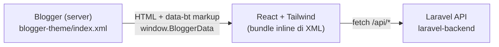

# Pesonaku — Custom Theme Blogspot

Custom theme Blogger yang menggabungkan **Blogger XML**, **React JS**, **Tailwind CSS**, dan **Laravel**.
Rencana lengkapnya ada di issue [#1](https://github.com/pesonaku/blogspot/issues/1).

## Arsitektur



| Bagian | Folder | Peran |
| --- | --- | --- |
| Blogger XML | `blogger-theme/` | Skeleton, SEO, routing, sumber konten (post, label, pager) |
| React + Tailwind | `react-frontend/` | Seluruh UI; dibuild jadi 1 file JS + 1 file CSS |
| Laravel | `laravel-backend/` | API tambahan (CORS hanya untuk `*.blogspot.com` + domain yang diizinkan) |

### Alur data Blogger → React

1. `<head>` template menulis `window.BloggerData` (judul blog, `pageType`, URL, dll).
2. Widget Blogger merender markup semantik di dalam `#root` dengan atribut `data-bt="…"`
   (bisa dibaca crawler & tetap tampil tanpa JS).
3. `react-frontend/src/lib/blogger.js` membaca markup itu, mengosongkan `#root`, lalu React merender UI.
4. Routing tetap milik Blogger. React hanya memilih tampilan dari `pageType`
   (`index`, `archive`, `item`, `static_page`, `error_page`). **Jangan pakai react-router.**

> Kontrak atribut `data-bt` di `blogger-theme/template.xml` harus selalu sama dengan `src/lib/blogger.js`.

## Kebutuhan

- Node.js 20+ (diuji dengan 24)
- PHP 8.3+ dengan ekstensi `openssl`, `mbstring`, `pdo_sqlite`, `fileinfo`, `curl`
- Composer 2

> Windows PowerShell: jika `npm` diblokir execution policy, pakai `npm.cmd`.

## Pengembangan

```bash
# 1) Laravel API → http://127.0.0.1:8000
cd laravel-backend
composer install
cp .env.example .env && php artisan key:generate   # jika .env belum ada
php artisan serve

# 2) React (preview dengan data mock) → http://localhost:5173
cd react-frontend
npm install
npm run dev
```

Preview tampilan lain: `http://localhost:5173/?page=item`, `?page=static_page`, `?page=404`.

## Build & upload tema

```bash
cd react-frontend
# PowerShell: $env:THEME_API_BASE_URL="https://api.domainku.com"; npm run build:theme
THEME_API_BASE_URL=https://api.domainku.com npm run build:theme
```

Perintah ini menjalankan `vite build`, menyisipkan `dist/blogger-theme.js` & `.css` ke
`blogger-theme/template.xml`, memvalidasi XML, lalu menulis **`blogger-theme/index.xml`**.

Upload di Blogger: **Tema → ▾ (di samping "Sesuaikan") → Pulihkan → pilih `blogger-theme/index.xml`**.

> [!IMPORTANT]
> Blog diakses lewat HTTPS, jadi Laravel API produksi **wajib HTTPS** (mixed content akan diblokir browser).
> Tambahkan domain kustom blog ke `CORS_ALLOWED_ORIGINS` di `laravel-backend/.env`.

## Struktur

```
blogger-theme/
  template.xml      ← sumber template (edit ini)
  index.xml         ← hasil generate, yang di-upload ke Blogger
react-frontend/
  src/              ← komponen React + Tailwind
  scripts/build-theme.mjs
laravel-backend/
  routes/api.php    ← GET /api/status
  config/cors.php
```

## Testing

```bash
cd laravel-backend && php artisan test   # endpoint + aturan CORS
cd react-frontend  && npm test           # parser data Blogger
```
